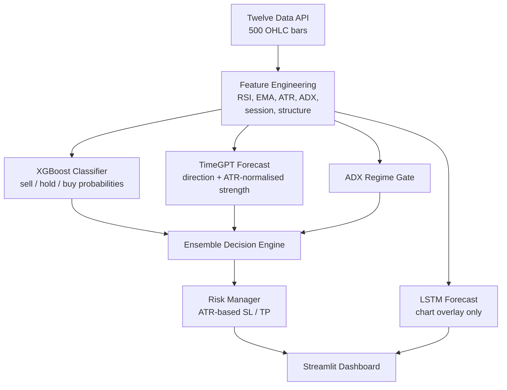

<div align="center">

# KAIROS

### Forex & Gold AI Signal Platform

A hybrid machine-learning signal engine that combines gradient-boosted classification, foundation-model time-series forecasting, and regime-aware risk management in a real-time Streamlit dashboard.


</div>

---

> **Disclaimer:** KAIROS is a research and decision-support tool, not financial advice and not an automated trading bot. Forex and CFD trading carries a high risk of loss. Signals are probabilistic, past performance does not indicate future results, and the system has not been validated by a formal backtest. Never risk money you cannot afford to lose.

---

## Table of Contents

- [Overview](#overview)
- [Screenshots](#screenshots)
- [Key Features](#key-features)
- [System Architecture](#system-architecture)
- [How a Signal Is Produced](#how-a-signal-is-produced)
- [Project Structure](#project-structure)
- [Getting Started](#getting-started)
- [Configuration](#configuration)
- [Usage](#usage)
- [Reading the Dashboard](#reading-the-dashboard)
- [Risk Management](#risk-management)
- [Known Limitations](#known-limitations)
- [Roadmap](#roadmap)
- [Troubleshooting](#troubleshooting)
- [Contributing](#contributing)
- [License](#license)

---

## Overview

KAIROS pulls live OHLC data for major forex pairs and gold, engineers technical and market-structure features, and produces a **BUY / SELL / HOLD** signal with a confidence score and ATR-based stop-loss / take-profit levels.

Rather than relying on a single model, KAIROS ensembles two independent views of the market:

| Component | Role | Input |
|---|---|---|
| **XGBoost classifier** | Learns directional bias from engineered features | 14 technical and structural features |
| **TimeGPT (Nixtla)** | Foundation-model price forecast | Raw close-price series |
| **ADX regime gate** | Suppresses signals in non-trending markets | ADX, +DI, -DI |
| **LSTM forecaster** | Visual forecast overlay on the chart | Recent close prices |

The design goal is not to predict every candle. It is to **filter**: stay out of low-quality conditions, and only surface a signal when the models and the market regime agree.

**Supported instruments:** EUR/USD, GBP/USD, USD/JPY, USD/CHF, AUD/USD, NZD/USD, USD/CAD, XAU/USD
**Supported timeframes:** 1min, 1h, 4h

---

## Screenshots

> Add your screenshots to `docs/screenshots/` and update the paths below.

| Dashboard | Signal Panel |
|---|---|
|  |  |

| Trending Regime | Choppy Regime (HOLD) |
|---|---|
|  |  |

---

## Key Features

- **Hybrid ensemble** of a supervised tree model and a pretrained time-series foundation model
- **Regime detection** using ADX with adaptive decision thresholds (stronger trend, lower threshold)
- **ATR-relative labelling** so training targets scale with current volatility instead of using fixed pip values
- **Lookahead-safe training**: the most recent bars are held out of the training set
- **Directional agreement logic**: boosts the score when models agree, penalises it when they conflict
- **Pair-aware and timeframe-aware risk levels** (separate multipliers for forex and gold)
- **Cached model training** so the UI stays responsive and the model is not refit on every refresh
- **Interactive Plotly chart** with candlesticks, EMA 20/50, LSTM forecast, and SL/TP lines
- **Built-in debug panel** exposing raw model probabilities so every decision is explainable
- **Secrets via environment variables**, with no keys in source control

---

## System Architecture



> The LSTM forecast is displayed on the chart for context only. It does **not** contribute to the ensemble score.

---

## How a Signal Is Produced

**1. Data ingestion.** The latest 500 bars are fetched from Twelve Data. 4h bars are resampled from 1h data with symbol metadata preserved.

**2. Feature engineering.** 14 features across four groups:

| Group | Features |
|---|---|
| Momentum | `rsi`, `roc`, `roc_atr` |
| Trend | `ema20`, `ema50`, `adx`, `adx_pos`, `adx_neg` |
| Volatility | `atr`, `volatility` |
| Structure and time | `dist_from_high`, `dist_from_low`, `session_sin`, `session_cos` |

**3. XGBoost classification.** Labels are generated from next-bar return relative to `0.10 x ATR`: above is BUY, below the negative is SELL, otherwise HOLD. The final 5 bars are excluded from training. The model outputs `[sell, hold, buy]` probabilities.

**4. TimeGPT forecast.** A 5-step-ahead forecast is compared to the last close. The signal direction comes from the sign of the move. Confidence is `|forecast - last| / (3 x ATR)`, capped at 1.0, so it is comparable across pairs.

**5. Regime gate and ensemble.**

```
raw_score = (0.65 x xgb_score x xgb_conf + 0.35 x tg_score x tg_conf) x agreement_multiplier
```

| ADX | Behaviour | Threshold |
|---|---|---|
| < 15 | Forced HOLD (flat market) | n/a |
| 15 - 20 | Weak trend | 0.15 |
| 20 - 25 | Moderate trend | 0.12 |
| >= 25 | Strong trend | 0.10 |

The agreement multiplier is `1.10` when both models point the same way and `0.80` when they conflict.

**6. Risk levels.** Stop-loss and take-profit are placed from the latest ATR using the multipliers below.

---

## Project Structure

```
kairos/
├── app.py                      # Streamlit entry point
├── kairos_config.py            # Pairs and timeframe configuration
├── requirements.txt
├── .env.example                # Environment variable template
│
├── api/
│   └── timegpt_model.py        # Nixtla TimeGPT forecasting client
│
├── data/
│   ├── fetch_data.py           # Twelve Data ingestion + 4h resampling
│   └── symbols.py              # Symbol mapping
│
├── features/
│   └── indicators.py           # Feature engineering
│
├── models/
│   ├── xgb_model.py            # XGBoost training and inference
│   └── lstm_model.py           # LSTM forecaster (chart overlay)
│
├── ensemble/
│   └── decision_engine.py      # Ensemble scoring + ADX regime gate
│
├── risk/
│   └── risk_manager.py         # ATR-based SL / TP
│
├── visualization/
│   └── charts.py               # Plotly chart builder
│
└── docs/
    └── screenshots/
```

---

## Getting Started

### Prerequisites

- Python **3.10+**
- A [Twelve Data](https://twelvedata.com/) API key (free tier available)
- A [Nixtla](https://www.nixtla.io/) API key for TimeGPT

### Installation

```bash
# 1. Clone the repository
git clone https://github.com/<your-username>/kairos.git
cd kairos

# 2. Create and activate a virtual environment
python -m venv venv

# Windows
venv\Scripts\activate
# macOS / Linux
source venv/bin/activate

# 3. Install dependencies
pip install -r requirements.txt
```

### Environment setup

```bash
# Windows
copy .env.example .env
# macOS / Linux
cp .env.example .env
```

Open `.env` and add your keys:

```env
TWELVE_DATA_KEY=your_twelve_data_key
NIXTLA_API_KEY=your_nixtla_key
```

> `.env` is git-ignored. **Never commit API keys.**

### Run

```bash
streamlit run app.py
```

The dashboard opens at `http://localhost:8501`.

---

## Configuration

| Setting | File | Description |
|---|---|---|
| `FOREX_PAIRS` | `kairos_config.py` | Instruments shown in the dropdown |
| `TIMEFRAMES` | `kairos_config.py` | Available chart timeframes |
| `SYMBOL_MAP` | `data/symbols.py` | Maps display names to Twelve Data symbols |
| Label sensitivity | `models/xgb_model.py` | `0.10 x ATR` target threshold |
| Ensemble weights | `ensemble/decision_engine.py` | Default 65% XGBoost / 35% TimeGPT |
| ADX thresholds | `ensemble/decision_engine.py` | Regime gate and decision thresholds |
| SL / TP multipliers | `risk/risk_manager.py` | Per asset class and timeframe |
| Model cache TTL | `app.py` | Default 3600 seconds |

---

## Usage

1. Select a **currency pair** and **timeframe**.
2. Check the **Market Regime** and **ADX** panel first.
3. Read the **Signal** and **Confidence**.
4. Review the suggested **Stop Loss** and **Take Profit** on the chart.
5. Enable **Show debug info** to inspect the raw XGBoost probabilities, TimeGPT output, ADX/DI values, RSI, and ATR behind the decision.

A sensible workflow is to check the **4h** signal for bias, then look for entries on **1h** in the same direction.

---

## Reading the Dashboard

| Metric | Meaning |
|---|---|
| **Market Regime** | Strong / Moderate / Weak trend, or Choppy |
| **ADX** | Trend strength (not direction) |
| **Signal** | BUY, SELL, or HOLD |
| **Confidence** | Strength of the ensemble score after `tanh` scaling |
| **Stop Loss / Take Profit** | ATR-based levels from the latest close |

**Suggested confidence interpretation:** below 0.40 is weak and should usually be ignored, 0.40 to 0.60 is marginal, and above 0.60 is stronger agreement. These are heuristics, not guarantees.

---

## Risk Management

SL / TP distances are expressed in multiples of ATR:

| Asset | Timeframe | Stop Loss | Take Profit |
|---|---|---|---|
| Forex | 1min | 2.5 x ATR | 4.0 x ATR |
| Forex | 1h | 1.5 x ATR | 3.0 x ATR |
| Forex | 4h | 1.2 x ATR | 2.5 x ATR |
| Gold | 1min | 2.0 x ATR | 3.5 x ATR |
| Gold | 1h | 1.5 x ATR | 3.0 x ATR |
| Gold | 4h | 1.2 x ATR | 2.5 x ATR |

**Position sizing guidance** (external to the app):

```
Risk amount = Account balance x risk % (1% recommended)
Lot size    = Risk amount / (stop distance in pips x pip value)
```

---

## Known Limitations

Being explicit about what KAIROS does **not** do:

- **No formal backtest or walk-forward validation yet.** Reported behaviour is qualitative.
- **No economic-news awareness.** Check a calendar before trading around high-impact releases.
- **Single-fit model per hour.** XGBoost is trained on the latest 500 bars, so it adapts quickly but has limited history.
- **Price-derived features dominate.** Most inputs are derived from OHLC, so signals can be correlated. Order flow, positioning (COT), and volume features are not yet included.
- **Spread and slippage are not modelled.** Short timeframes are especially sensitive to these.
- **TimeGPT is skipped on the 1-minute timeframe.**
- **Free-tier API limits apply.** Twelve Data's free plan is rate-limited per minute and per day.
- **LSTM is trained on-the-fly for visualization only** and has no influence on the signal.

---

## Roadmap

- [ ] Walk-forward backtesting engine with transaction costs
- [ ] Performance analytics (win rate, expectancy, drawdown, Sharpe)
- [ ] Economic calendar integration with a news-blackout filter
- [ ] COT positioning and order-flow features
- [ ] Higher-timeframe confirmation built into the signal
- [ ] Probability calibration of ensemble confidence
- [ ] Persistent trade journal and signal history
- [ ] Optional broker / MetaTrader 5 integration (paper trading first)
- [ ] Dockerfile and CI pipeline

---

## Troubleshooting

**`ImportError: cannot import name 'FOREX_PAIRS' from 'config'`**
A third-party `config` package is shadowing the local module. This project uses `kairos_config.py` to avoid the conflict.

**`TwelveData error: apikey parameter is incorrect or not specified`**
Your `.env` file is missing, misplaced, or the key is wrong. It must sit in the project root with no quotes or spaces around `=`.

**`ValueError: feature_names mismatch`**
A cached model trained on an older feature set is being reused. Stop Streamlit completely (`Ctrl+C`) and restart, or run `streamlit cache clear`.

**Signal is always HOLD**
Enable the debug panel and compare the XGBoost score against the current threshold. HOLD is the correct output when ADX is below 15 or the ensemble score is inside the threshold band.

**Rate-limit errors from Twelve Data**
Reduce refresh frequency or upgrade your plan. Data is cached for 60 seconds by default.

---

## Contributing

Contributions are welcome.

1. Fork the repository
2. Create a feature branch: `git checkout -b feature/your-feature`
3. Commit your changes: `git commit -m "Add your feature"`
4. Push the branch: `git push origin feature/your-feature`
5. Open a Pull Request

Please open an issue first for major changes.

---

## License

Distributed under the MIT License. See [`LICENSE`](LICENSE) for details.

---

## Acknowledgements

- [Twelve Data](https://twelvedata.com/) for market data
- [Nixtla TimeGPT](https://www.nixtla.io/) for time-series foundation-model forecasting
- [XGBoost](https://xgboost.ai/), [PyTorch](https://pytorch.org/), [Streamlit](https://streamlit.io/), [Plotly](https://plotly.com/), and [`ta`](https://github.com/bukosabino/ta)

---

<div align="center">

**Built by Pasindu**
Not financial advice. Trade responsibly.

</div>
